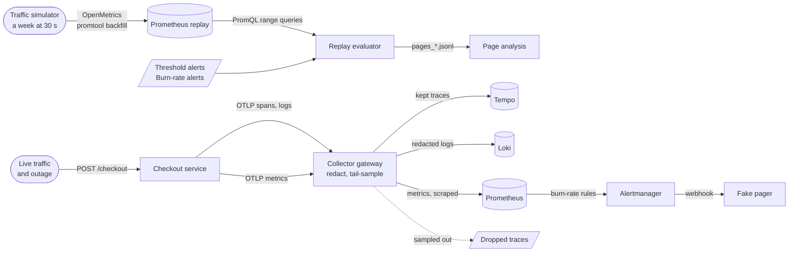

# Architecture

A small checkout service with the alerting a team could live with, and a telemetry pipeline that keeps what an incident
needs while removing what must never be stored. Component names match the lesson's two diagrams: traffic simulator,
service, threshold alerts, burn-rate alerts, fake pager; and service, Collector gateway, trace backend, dropped traces.

## Components and what each owns

| Component | Owns | Does not own |
|---|---|---|
| **Traffic simulator** (`slo_lab.domain.traffic`, `slo_lab.lab.replay`) | a seeded model of a week at 30-second resolution with four planted incidents; writing it as OpenMetrics and backfilling it with `promtool` | wall-clock time: a week replays in seconds |
| **Checkout service** (`slo_lab.interfaces.service_main`) | `POST /checkout`, `GET /healthz`; the SLI metrics `http_requests_total` and `http_request_duration_seconds`; spans and logs; the lab-only `simulate` field | deciding what is sampled or redacted |
| **Collector gateway** (contrib 0.111.0, `observability/collector/gateway.yaml`) | `memory_limiter`; redaction of emails and card-like numbers in span attributes and log bodies; tail sampling of traces; routing to Tempo, Prometheus, Loki | the metrics: they are never sampled or redacted |
| **Tempo / Loki** | the stored traces and logs | policy |
| **Prometheus 2.54.1** (live) | the SLI series, the generated burn-rate rules, notifying Alertmanager | the threshold alerts (never loaded live) |
| **Prometheus replay** (profile `replay`) | the backfilled week; PromQL over it | rules: the replay evaluates expressions itself |
| **Alertmanager 0.27.0** | grouping by alert name and sending one webhook per firing alert | what a page means |
| **Fake pager** (`slo_lab.interfaces.pager_main`) | counting and timestamping every webhook it receives (a JSON-lines file) | paging anyone |
| **Threshold alerts** (`replay/threshold.rules.yml`) | the noisy baseline: `HighCPU` (above 80% for a minute) and `AnyError` (any 5xx in a minute) | being run live |
| **Burn-rate alerts** (`rules/burn_rate.rules.yml`, generated) | the page and the ticket for each SLO | being edited by hand |
| **Grafana 11.2.0** | two dashboards as code: the live SLIs and burn rates, and the replayed week. For a person to look at: none of the runs below uses it; only the health check and one integration test ask it whether its datasources answer | any data |

## Data flow

Drawn versions of this figure and of the walk-through: [the architecture](docs/diagrams/architecture.svg) and [one run](docs/diagrams/flow.svg).

### One run, step by step

**Replay (`make replay`, lesson steps 1 to 4)**

1. `simulate()` yields 20,160 ticks (a week of 30-second intervals). Requests are Poisson around 500 a minute with a daily
   swing; errors are binomial at the ordinary rate, or the incident's rate while an incident is active.
2. `write_week()` turns the ticks into cumulative counters, a latency histogram and a CPU gauge in OpenMetrics.
3. `promtool tsdb create-blocks-from openmetrics` writes TSDB blocks into a Docker volume; `prometheus-replay` starts on
   that volume.
4. For each alert set (threshold, the lesson's burn-rate numbers, this repository's burn-rate policy), each rule's
   expression is run as a range query at one-minute steps. A step with any result is a step where the expression is true.
5. `firing_episodes()` applies the `for` duration exactly as Prometheus does (pending, then firing, then resolved); each
   episode is one page.
6. `classify()` compares the pages with the planted incidents: a page that starts inside a user-facing incident (or within
   15 minutes after it) is actionable; the rest are false alarms, attributed to a quiet incident or to baseline noise.

**Volume and redaction (`make volume`, steps 5 and 6)**

1. The gateway is recreated with `gateway.raw.yaml` (no sampling, no redaction). Seeded traffic is sent: ordinary requests,
   3% planted errors, 1% planted slow requests (1.4 s), 5% carrying a test email and a published test card number.
2. After the sampler's wait, the scenario reads how many bytes Tempo and Loki accepted, looks up every planted trace by
   the trace id the client received, and searches Tempo's stored traces and Loki's lines for the test values.
3. The gateway is recreated with `gateway.yaml` and the same traffic is sent again. The raw pass is the positive control:
   the test values must be found there, or finding none in the second pass proves nothing.

**Live page (`make live`)**

1. Healthy traffic for two minutes, then every request fails for three. Prometheus (live) evaluates the generated rules every
   five seconds, Alertmanager groups and sends a webhook, the fake pager records it. The test asserts the page arrived.

## The pattern and the layers

Ports and adapters. `domain/` is pure: SLOs and their budgets, burn-rate arithmetic, the traffic model, alert-firing
semantics, page classification, and the checkout request. `application/` holds the use cases (`PlaceCheckout`,
`build_alert_rules`, `ReplayAlerts`, `Comparison`) and the ports (`RangeEvaluator`, `Annotator`, `Delay`, `Reference`,
`PageStore`). `infrastructure/` implements them with OpenTelemetry, YAML, the Prometheus HTTP API and a JSON-lines file.
`interfaces/` is the two Flask apps and the composition roots; `lab/` is the experiment, a sibling of `interfaces/`.
`import-linter` enforces the direction in `make lint`; domain and application may not import Flask, requests, YAML or
OpenTelemetry.

The central design idea is that **thresholds are derived, never typed**: `slos.yaml` and `policies.yaml` are the source;
`build_alert_rules` computes each threshold from the burn rate and the error budget; `make rules` writes the rule files;
`make lint` fails if a file is stale. The same domain objects produce the numbers in `docs/slo.md` (a test checks them).

## Decisions and trade-offs

- [0001](docs/adr/0001-replay-by-backfill-and-range-queries.md): replay a week by backfilling it and evaluating rules as
  range queries, not by playing it in real time.
- [0002](docs/adr/0002-a-ticket-tier-that-sees-a-two-hour-degradation.md): the ticket tier is 5x over two hours, not the
  lesson's 6x over six, which cannot see the planted degradation.
- [0003](docs/adr/0003-redact-first-then-sample.md): redaction runs before tail sampling, and replaces the sensitive value
  inside the field instead of deleting the field.
- [0004](docs/adr/0004-metrics-are-never-sampled.md): only traces are sampled; metrics and therefore the SLIs are untouched.

## Failure modes the lesson teaches, and where the code shows them

| Failure | Where it shows |
|---|---|
| Threshold alerts page on causes and noise | `make replay`: `AnyError` and `HighCPU` pages by cause; the CPU spike pages; the burn-rate set is silent for it |
| A short blip pages someone | promtool test "a 90 second blip pages no one because the one-hour window never agrees"; remove the long window from the generated expression and it fails |
| Standard thresholds miss a real incident | the lesson's own numbers, replayed, miss the two-hour degradation (`burn_rate_lesson` set); the tuned policy catches it |
| Tail sampling with only a probabilistic policy drops the evidence | `gateway.yaml` has three policies; `tests/observability` asserts all three; the volume report shows every planted error and slow trace found |
| Redacting by deleting the field | the patterns replace only the matched value (`<email>`, `<card>`), and a test shows the surrounding text survives |
| Checking one backend only | the volume report searches both Tempo and Loki, for both the email and the card |
| Declaring success from the page count alone | `Comparison.improved` is false if any user-facing incident went unalerted, however few the pages |

## Limits of the teaching build against a production one

- A single gateway instance holds each trace's spans, so tail sampling needs no routing tier. With several gateway
  replicas the earlier tier must use the `loadbalancing` exporter keyed on trace id, or a trace's spans land on different
  replicas and are sampled separately.
- Tail sampling holds up to 50,000 traces in memory for ten seconds; production sizes `num_traces` and `decision_wait`
  from real throughput and trace duration.
- The replay is evaluated at one-minute steps and ignores Alertmanager's grouping delays, `group_interval`,
  `repeat_interval` and inhibition (the live Alertmanager silences a slow-burn ticket while the page for the same SLO
  fires); a page is one firing episode.
- The simulated week is synthetic: no real diurnal shape, no deploys, no dependencies failing.
- `ALLOW_SIMULATION=true` lets any client make a request fail; a production service has no such field.
- Redaction is pattern-based. It catches emails and card-like digit strings; it does not know names, addresses or numbers
  in other shapes. A real deployment adds allow-lists of attribute keys and reviews new attributes.

## How to extend it

- **Another SLO:** add an entry to `slos.yaml` with `good` and `valid` expressions; `make rules` generates its alerts and
  `make test` checks the document and the rules are consistent.
- **A background-job SLO:** the unit is runs, not requests: `good` = runs that finished on time, `valid` = runs started.
- **eBPF or wide events:** add a second service that is not instrumented, run an eBPF agent against it, and compare its
  spans with the instrumented service's.
